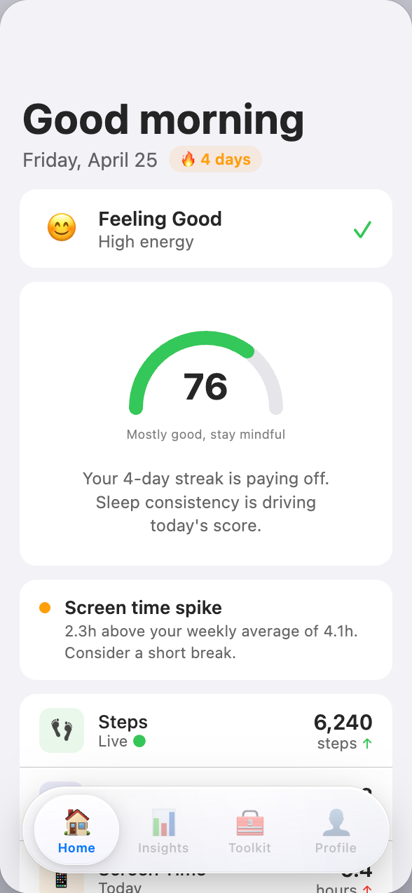
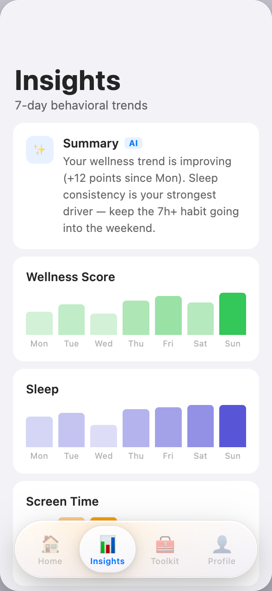
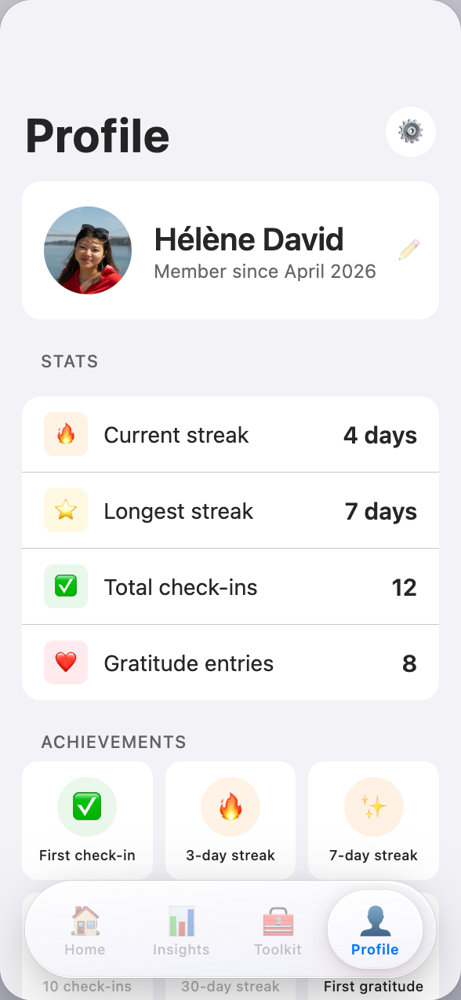

# CalmCampus

**A privacy-first wellness companion for university students.**

[](LICENSE)


[**cc.braunf.com**](https://cc.braunf.com/) · [Impact report](https://cc.braunf.com/report.html) · [Evidence dossier](research/CalmCampus-Evidence-Dossier.pdf)

<p align="center">
  
  
  
</p>
<p align="center"><sub>Design mockups of the planned app screens.</sub></p>

CalmCampus helps students notice when stress is building up, using signals their phone already has (sleep, activity, screen time) plus a short daily check-in. It then offers brief, evidence-based exercises: breathing, grounding, progressive muscle relaxation, thought reframing and gratitude. **All data stays on the device.**

Originally built for the **KU Leuven KICK Challenge 2026**.

> CalmCampus is a wellness tool, not a medical device. It does not diagnose or treat any condition and is no substitute for professional help. If you are in crisis, contact your local emergency number or a crisis line.

## Status

The project is being rebuilt as native apps: **SwiftUI on iOS first, then Kotlin/Jetpack Compose on Android**, so passive sensing (HealthKit, Screen Time, Health Connect) and on-device AI can use the platform APIs directly. The earlier Flutter prototype is preserved at git tag [`flutter-final`](https://github.com/lumenworksco/CalmCampus/tree/flutter-final).

| Area | State |
|---|---|
| Adaptive daily check-in (iOS) | Implemented, with unit-tested planner |
| HealthKit sleep and step signals (iOS) | Implemented, behind a provider protocol so it can be tested without Apple Health data |
| On-device reframing model | v0.1 research preview, see [`ml/`](ml/) |
| Feasibility spike | Done, see [`spike/`](spike/) |
| Pilot with KU Leuven students (TestFlight) | Planned |
| Android app | Planned |

## Roadmap

1. **Feasibility spike**: measure which signals iOS actually provides and how reliably.
2. **iOS MVP**: real signals only, a calibration period for new users, on-device AI.
3. **Pilot**: do passive signals track self-reported check-ins?
4. **Android**: Kotlin/Compose with Health Connect, sharing the scoring engine.

## Repository layout

```
ios/            The iOS app (SwiftUI + SwiftData, XcodeGen project)
spike/          iOS feasibility spike (XcodeGen project)
ml/             On-device reframing model: data, training, evaluation, model card
research/       Evidence dossier and source index backing the site's claims
docs/           Pitch site and impact report (GitHub Pages, cc.braunf.com)
design/         HTML mockups of the app screens, app icon and palette
```

## Getting started

You need macOS with full Xcode and [XcodeGen](https://github.com/yonaskolb/XcodeGen) (`brew install xcodegen`). The `.xcodeproj` files are generated from `project.yml` and are not committed.

```bash
# Build and open the iOS app
cd ios && xcodegen generate && open -a Xcode CalmCampus.xcodeproj

# Run the unit tests (adjust the simulator name to one you have installed)
xcodebuild test -project ios/CalmCampus.xcodeproj -scheme CalmCampus \
  -destination 'platform=iOS Simulator,name=iPhone 16'

# Preview the website
python3 -m http.server 3400 --directory docs
```

The reframing model has its own setup, see [`ml/README.md`](ml/README.md).

## Design principles

- **All data stays on-device.** No cloud storage, analytics or accounts. Users can delete all their data at any time.
- **On-device AI only** (Apple Foundation Models, MLX, Gemini Nano). User text is never sent to a cloud API.
- **No synthetic data in the product.** Every signal is real, missing or unavailable, never fabricated.
- **Light-touch check-ins.** A small question budget, every question skippable, and no clinical screeners or self-harm items.
- **Wellness wording, not medical claims.** The app "supports", it does not "detect burnout".

## Contributing

Issues and pull requests are welcome, see [CONTRIBUTING.md](CONTRIBUTING.md). To report a security or privacy problem, see [SECURITY.md](SECURITY.md).

## Team

- **Florian Braun**: Engineering Technology, UCLL
- **Helene David**: Economics and Business, UCLL

## License

[MIT](LICENSE) © 2026 Florian Braun, Helene David. The fine-tuned model in `ml/` is derived from Qwen3-1.7B (Apache-2.0), see its [model card](ml/MODEL_CARD.md).
